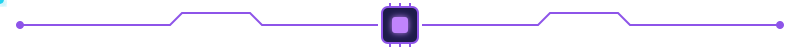
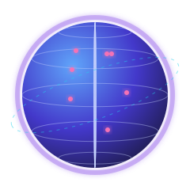
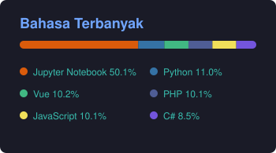

  

  

<h3 align="center">Menghubungkan ruang fisik dengan kembaran digitalnya, satu sensor dalam satu waktu.</h3>

### Halo 👋

Saya **Muhammad Raihan Alfarizi**, mahasiswa Informatika di **Universitas Amikom Yogyakarta** 🇮🇩

Saya meneliti **Digital Twin untuk manajemen energi bangunan cerdas**: data sensor IoT dikumpulkan, diolah di edge dan cloud, lalu ditampilkan sebagai model 3D di web.
Tujuan saya adalah **membuat konsumsi energi bangunan terlihat, terukur, dan bisa diprediksi.** ⚡

Saya tertarik pada:

- Digital Twin & visualisasi 3D web 🌐
- IoT & sistem tertanam 📡
- Data mining & machine learning 📊

 

## Status Saat Ini

👉 Meneliti kerangka **Digital Twin canonical-state** untuk prediksi daya ruangan yang sadar okupansi 🔬

👉 Mengembangkan dashboard Digital Twin dengan **Vue, Cesium, dan Babylon.js** 🏢

👉 Mengolah data sensor dari **ESP32 dan Raspberry Pi** 📡

👉 Mendalami **big data, machine learning, dan fullstack development** 💻

`Update Mei 2026:` Mengumpulkan data sensor IoT selama 20–24 Mei 2026 untuk [prediksi konsumsi daya](https://github.com/rehanalfarizu/digital-twin-iot-power-prediction).

`Update Nov 2026:` Menyelesaikan tahap 2–6 eksperimen di repo riset [new_jurnal](https://github.com/rehanalfarizu/new_jurnal).

 

## GitHub Stats 👨‍💻

  
  
  

## Skills 🌱

Lihat skills

 

  

| Bidang | Teknologi |
| --- | --- |
| Data & ML | Python, Jupyter, PySpark, TensorFlow, Streamlit |
| Web | Vue, Vite, JavaScript, PHP, Laravel, MySQL |
| 3D & Digital Twin | Cesium, Babylon.js, Unity (C#) |
| IoT | ESP32, Raspberry Pi |

## Proyek & Riset 🔥

Lihat proyek unggulan

 

| Proyek | Ringkasan | Teknologi |
| --- | --- | --- |
| 🔬 [new_jurnal](https://github.com/rehanalfarizu/new_jurnal) | Kerangka Digital Twin canonical-state untuk prediksi daya ruangan yang sadar okupansi | Python, Jupyter |
| ☁️ [jurnal_penelitian](https://github.com/rehanalfarizu/jurnal_penelitian) | Arsitektur edge–cloud dengan fusi data multimodal untuk Digital Twin Web-3D | Python, Jupyter |
| 🏢 [digital-twin](https://github.com/rehanalfarizu/digital-twin) | Dashboard Digital Twin untuk monitoring lingkungan real-time lewat IoT | Vue, Vite |
| ⚡ [digital-twin-iot-power-prediction](https://github.com/rehanalfarizu/digital-twin-iot-power-prediction) | Prediksi daya listrik dari data sensor IoT dengan dashboard Streamlit | Python, Streamlit |
| 🚚 [mining-digitaltwin-3d-design](https://github.com/rehanalfarizu/mining-digitaltwin-3d-design) | Model 3D truk tambang dengan skrip kamera dan pergerakan | Unity, C# |
| 🎓 [website-magang](https://github.com/rehanalfarizu/website-magang) | Sistem pendaftaran dan monitoring magang Prodi Informatika AMIKOM (proyek tim) | Laravel, PHP |

Lihat proyek data mining & machine learning

 

- [big-data-mining-](https://github.com/rehanalfarizu/big-data-mining-): predictive dan descriptive analytics
- [stackoverflow-analytics-pyspark-nlp](https://github.com/rehanalfarizu/stackoverflow-analytics-pyspark-nlp): analitik big data dengan PySpark dan NLP
- [Deteksi Anomali Log Sistem](https://github.com/rehanalfarizu/-Deteksi-Anomali-Log-Sistem-Menggunakan-Model-Sequence-Berbasis-Deep-Learning): deteksi anomali dengan model sequence deep learning

<h3 align="center">📫 <a href="mailto:rehanalfarizi@students.amikom.ac.id">rehanalfarizi@students.amikom.ac.id</a></h3>

  

